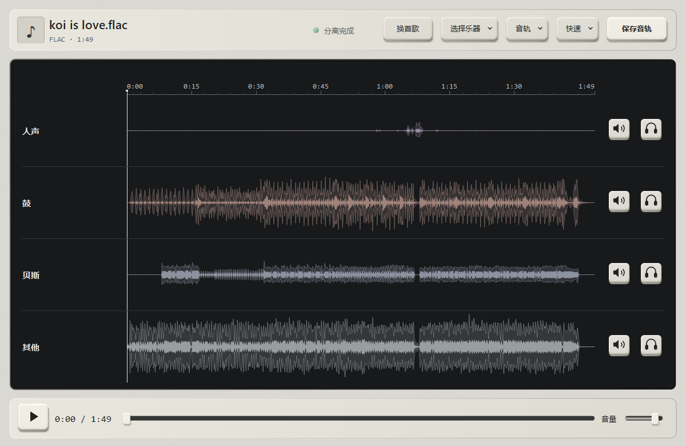
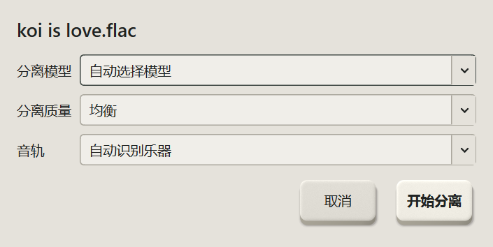
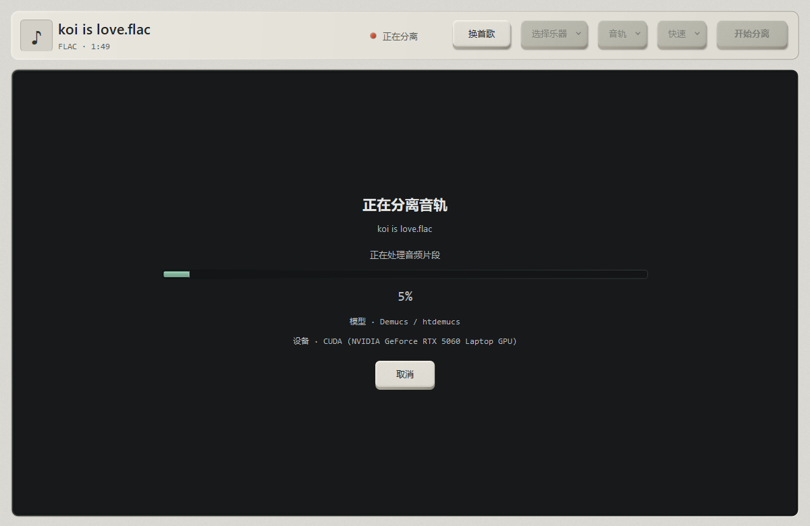
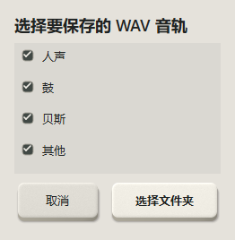

# 音轨分离 · Local AI Music Stem Separator

把一首歌拆成几条可以单独试听和保存的音轨。想减弱人声做伴奏，或单独听一听鼓和贝斯，拖入一首歌就能开始。音频在 Windows 电脑上处理。

**[下载 Windows 安装包（64 位）](https://github.com/zkmaojack/local-ai-music-stem-separator/releases/download/v0.2.0/StemSeparator-0.2.0-windows-x64-setup.exe)** · [查看发布页](https://github.com/zkmaojack/local-ai-music-stem-separator/releases/tag/v0.2.0)

上图和以下教程使用 GitHub 上的当前源码版本。现有 v0.2.0 安装包的按钮位置和自动识别选项可能不同。

## 安装

1. 下载并运行上面的安装包，按提示完成安装。安装器提供 CPU 和 NVIDIA 显卡选项。不确定选哪项时，选 CPU 即可。
2. 安装时保持联网，并勾选「准备全部本地模型」即可同时下载模型。这一步需要几 GB 磁盘空间。准备好后，导入、分离和保存音轨都可以离线完成。
3. 在 Windows 开始菜单搜索 **Local AI Music Stem Separator** 并打开。

## 用一首歌试试

### 1. 导入歌曲，开始分离

把歌曲拖进窗口，也可以点击「选择歌曲」。支持常见的 MP3、WAV、FLAC、M4A 和 OGG 文件。

第一次可以选「自动识别乐器」和「均衡」，让软件决定先分哪些轨。如果只想把人声、鼓、贝斯和其他声音分开，可以直接选「标准四轨」。然后点击「开始分离」，等待窗口显示「分离完成」。

查看分离时的进度界面

### 2. 播放，单独听一条轨

点击左下角的播放键。点击波形的任意位置，可从那里开始试听。

- **扬声器**可以开关这条音轨的声音。想听伴奏，可以先静音人声。
- **耳机**可以只听这一条音轨。再按一次，就会回到之前的试听状态。
- **音轨**菜单可以找回自动折叠的轨道，也可以隐藏暂时用不到的轨道。隐藏只影响列表显示。

### 3. 保存想要的声音

点击「保存音轨」，勾选需要的轨道，再点「选择文件夹」。每条轨道会保存为独立的 WAV 文件。如果要保留结果，请在换歌或退出前保存。退出后，程序会清理未保存的临时结果。

## 常见问题

- **电脑速度不快，选哪一档？** 先试「快速」。「均衡」适合平时使用，「高质量」会花更长时间。实际耗时也取决于歌曲长度和电脑性能。
- **想单独提取小提琴、钢琴或某种电子音效？** 在「选择乐器」里搜索对应声音。部分乐器和音效属于实验功能，复杂混音可能出现串音或漏检，建议先独听再保存。
- **软件提示缺少本地模型？** 按提示检查所需模型。安装时可以勾选「准备全部本地模型」一次下载。
- **手边没有试用歌曲？** 可以打开样本页，点 **Original file** 下载 Kevin MacLeod 的《DD Groove》。[试用音频（CC BY 3.0）](https://commons.wikimedia.org/wiki/File:Kevin_MacLeod_-_04_-_DD_Groove.ogg)

[源码运行、命令行与依赖授权](docs/developer-guide.md) · [自动识别和分离的实测报告](docs/automatic-recognition-report.md)
